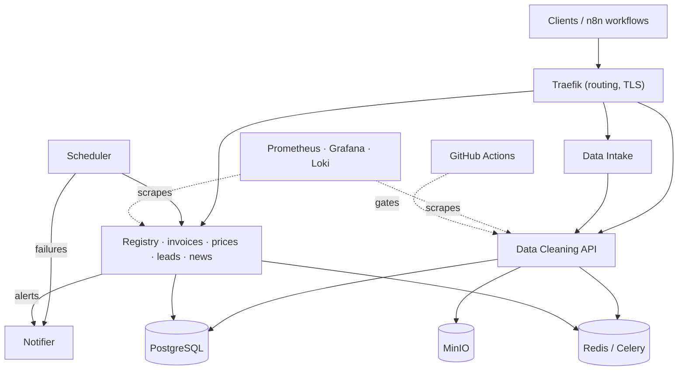

# Automation & Backend Engineering Portfolio

Thirty-one automation, backend, AI and QA projects: twelve core services (data intake, cleaning,
notifications, scheduling, OCR, scraping, observability, CI/CD) designed to run together as one
self-hosted stack, eleven client-facing builds for restaurants, e-commerce, AI agents and QA,
three QA automation suites (Playwright, Cypress, API contracts), five QA projects on production open-source systems, and four further automation projects: a Selenium to Playwright migration, Android automation, a performance gate and a test case generator with its evaluation.

Every row below has code and tests. The *Evidence* column says where the tests ran: **CI** means
a GitHub Actions workflow runs them on every push that touches the project; otherwise they were run locally
(or in Docker) during review. *Nightly* means a scheduled run of the heavier suites, which GitHub starts only from the default branch. Each project README lists its limits.

## Current status (2026-11-19)

### Core services

| #  | Project | What it does | Stack | Evidence |
| -- | ------- | ------------ | ----- | -------- |
| [Smart Data Intake](smart-data-intake/) | Ingests CSVs and messy Excel files (several sheets, merged headers, title and total rows) and sorts each row into clean, needs-review or error; a person reviews the doubtful ones in a panel | n8n, FastAPI, Pandas, openpyxl, Postgres, Redis, MinIO, Streamlit | 26 tests |
| [Business Registry Enricher](business-registry-enricher/) | Enriches company records from EU registries (VIES, Companies House, INSEE) with a 30-day cache and rate limits | n8n, FastAPI, Postgres, `aiolimiter`, `tenacity`, `zeep` | 72 tests |
| [Multi-Channel Notifier](multi-channel-notifier/) | One API for email, Slack, Telegram and Discord with templates, a queue, retries and a delivery log | FastAPI, Celery, Redis, Postgres, Jinja2 | 86 tests |
| [Data Cleaning API](data-cleaning-api/) | Cleans, validates and transforms CSV/Excel/JSON data for no-code workflows | FastAPI, Pandas, Pandera, Celery, Postgres, MinIO | 53 tests + 3 integration · 84% cov · CI · [risks](data-cleaning-api/docs/RISK-ANALYSIS.md) |
| [Invoice Processor](invoice-processor/) | Extracts invoices and ACORD 25 insurance certificates from PDF, Excel and images, by regular expressions or a language model, with the page and text fragment of every field; checks totals and the Colombian NIT check digit | FastAPI, pypdf, openpyxl, Tesseract, Ollama, Celery, Postgres, MinIO | 37 tests · CI; 4 integration tests with real OCR in Docker; [accuracy on 40 labelled documents](invoice-processor/evals/results.md) |
| [Scheduler Engine](scheduler-engine/) | Visual cron replacement: schedules HTTP calls, commands and Python scripts with retries and alerts, behind a Bearer-token API | FastAPI, Celery Beat, Postgres, Redis, Streamlit | 27 tests + 2 integration |
| [Price Monitor](price-monitor/) | Tracks prices by polite scraping and the MercadoLibre API (with an SSRF guard), keeps history and alerts by webhook | FastAPI, Playwright, Celery, Postgres, Streamlit, Plotly | 38 tests + 2 integration |
| [Lead Generator](lead-generator/) | Finds businesses in directories and websites, removes duplicates, validates emails, scores leads and exports Excel | FastAPI, Playwright, Postgres, `rapidfuzz`, `openpyxl` | 70 tests |
| [News Aggregator](news-aggregator/) | Collects RSS and web news (http/https only, SSRF guard), removes duplicates by hash and pgvector, summarises with an LLM and emails an HTML digest | FastAPI, feedparser, trafilatura, Postgres + pgvector, Ollama | 27 tests + 1 integration |
| [Docker Compose Lab](docker-compose-lab/) | Shared production topology for all services | Docker Compose, Traefik, Postgres, Redis, MinIO, n8n, Prometheus, Grafana | Backend: 5 tests, 61% cov · CI; full stack run locally (10 services, 9 with healthchecks; TLS on a real domain not tested) |
| [Monitoring Dashboard](monitoring-dashboard/) | Prometheus scrapes every 5 s, Loki + Promtail collect logs, Alertmanager sends 5 alert rules, Grafana shows dashboards | Prometheus, Grafana, Loki, Alertmanager, Node Exporter, FastAPI | 13 tests + 6 integration |
| [CI/CD Pipeline](ci-cd-pipeline/) | Lint, type-check, SAST, tests, non-root image build, Trivy scan and manual rollback | GitHub Actions, Ruff, Mypy, Bandit, Testcontainers, Trivy, GHCR | 14 tests + 1 integration · 96% cov · [own CI](.github/workflows/ci-cd-pipeline.yml) |

### Client-facing builds

| #  | Project | What it does | Stack | Evidence |
| -- | ------- | ------------ | ----- | -------- |
| [WhatsApp Restaurant Assistant](whatsapp-restaurant-assistant/) | Answers a restaurant's WhatsApp: orders, bookings, event requests and hand-off to staff | FastAPI, Postgres, WhatsApp Cloud API, LLM tools, BM25 | 159 tests · [30 evaluation conversations](whatsapp-restaurant-assistant/evals/RESULTS.md) |
| [n8n Automation Pack](n8n-automation-pack/) | Four flows: web form to CRM, invoice PDF to data with AI, daily AI sales report, payment to order | n8n, Postgres, Mailpit, LLM | 22 tests against a real n8n |
| [QA Showcase (Python)](qa-showcase/) | UI tests (Playwright on Edge) and API tests (httpx) on SauceDemo and Restful Booker, with 5 real bugs documented | Playwright, pytest, httpx, Postman | 21 passing + 5 tests that pin the documented bugs · CI ([workflow](.github/workflows/qa-showcase.yml)) |
| [Restaurant Website](restaurant-website/) | WordPress site built from scratch by script, with booking and event forms and structured data | WordPress, WP-CLI, Docker, Playwright | 10 tests on Edge · Lighthouse 81 / 95 / 100 / 92 |
| [Multi-Agent Crews](multi-agent-crews/) | The same four-agent market-research team in CrewAI and AutoGen behind one API; tools record the sources | CrewAI, AutoGen, FastAPI, Ollama | 20 tests |
| [MCP Agent Evals](mcp-agent-evals/) | Restaurant tools over MCP plus 30 eval cases: right tool, no invented answers, prompt-injection resistance | MCP, SQLite, Ollama, pytest | 35 tests · eval cases: 30/30 with the rule-based stub, which is a self-check of the harness, and 13/30 with a local 4B model (`qwen3:4b-instruct`); the README reads every failed case |
| [QA Java Suite](qa-java-suite/) | Selenium on Edge with JUnit 5 and Cucumber, REST Assured CRUD, Allure report | Java 21, Selenium, Cucumber, JUnit 5, REST Assured, Allure | 35 tests in Docker |
| [E-commerce Order Automation](ecommerce-order-automation/) | WooCommerce, Shopify and Stripe orders with verified signatures, no duplicates, customer email and a dashboard | FastAPI, MongoDB, Mailpit | 31 tests + end-to-end demo · [field mapping](ecommerce-order-automation/docs/FIELD-MAPPING.md) |
| [SEO & AEO Audit](seo-aeo-audit/) | Technical SEO, headings, schema, broken links, Lighthouse and answer-engine readiness, as an HTML or PDF report | FastAPI, BeautifulSoup, Lighthouse | 28 tests |
| [Web Chat Widget](web-chat-widget/) | One-line embeddable chat that talks to the restaurant assistant | TypeScript, React, FastAPI, Playwright | 8 tests |
| [Video Repurposing Kit](video-repurposing-kit/) | Transcribes a long video locally, picks the best moments and renders 9:16 clips with captions plus a YouTube pack | faster-whisper, FFmpeg, Ollama, FastAPI | 24 tests + a real 1080×1920 clip |

### QA automation suites

| #  | Project | What it does | Stack | Evidence |
| -- | ------- | ------------ | ----- | -------- |
| [Playwright + TypeScript on ParaBank](playwright-ts-parabank/) | Banking UI tests checked against the REST API (transfers verified by balance), page objects as fixtures, one visual test; a separate Bill Pay automation types extracted invoice records into the form, with retries and a never-twice guarantee (16 unit tests) | Playwright, TypeScript, Docker | 25 tests (10 API + 15 Edge) · CI ([workflow](.github/workflows/playwright-ts-parabank.yml)); Firefox and WebKit on manual runs · 3 bugs |
| [Cypress + TypeScript on OWASP Juice Shop](cypress-juice-shop/) | Login, catalog, basket, checkout, API and network-failure tests, with security defects written up | Cypress, TypeScript, Docker | 23 tests on Edge · CI ([workflow](.github/workflows/cypress-juice-shop.yml)) · 4 bugs |
| [API Contract Quality](api-contract-quality/) | Pact consumer contracts for the project `web-chat-widget` → 13 chat API, Schemathesis fuzzing of project `ecommerce-order-automation`'s OpenAPI, Newman regression on Petstore | Pact, Pact Broker, Schemathesis, Newman | 3 contract tests + 17 Newman requests (49 assertions) · CI ([workflow](.github/workflows/api-contract-quality.yml)); provider verification and fuzzing on manual runs · 3 bug reports: two defects in project `whatsapp-restaurant-assistant` (fixed since) and 7 schema mismatches in project `ecommerce-order-automation` |

### Automation frameworks, second set

| #  | Project | What it does | Stack | Evidence |
| -- | ------- | ------------ | ----- | -------- |
| [Selenium to Playwright migration](selenium-to-playwright-migration/) | The same 8 Juice Shop scenarios written in Selenium 4 and in Playwright, benchmarked over repeated runs for duration and intermittent failures | Python, Selenium 4, Playwright, Edge, Docker | 16 UI tests + 6 unit tests · CI ([workflow](.github/workflows/selenium-to-playwright-migration.yml)) publishes the benchmark table on every run |
| [Mobile automation on Android](mobile-appium-android/) | Catalog, sorting, cart and login scenarios on the Sauce Labs My Demo App with screen objects and explicit waits | Appium 3, UiAutomator2, Python, pytest | 7 tests on an Android 14 emulator · CI ([workflow](.github/workflows/mobile-appium-android.yml)) |
| [Performance gate with k6](performance-k6/) | Smoke, load, spike and forged-signature scenarios against the order service of project `ecommerce-order-automation`, absolute thresholds, a baseline comparison and a trend table across runs | k6, Docker, Python | 4 scenarios + 6 script tests · CI ([workflow](.github/workflows/performance-k6.yml)) · 1 defect found in project `ecommerce-order-automation`, fixed |
| [Test case generator with evaluation](test-case-generator-evals/) | Generates test cases by level from a requirement with a local model, and measures them: schema validity, coverage checked against hand-written expressions, invented criterion references, duplicates | Python, pydantic, Ollama | 22 tests · CI ([workflow](.github/workflows/test-case-generator-evals.yml)) on the stub · real-model run: 3 of 5 thresholds on the test split |

### QA on production open-source systems

| #  | Project | What it does | Stack | Evidence |
| -- | ------- | ------------ | ----- | -------- |
| [Saleor Order Integrity](commerce-order-integrity/) | Order, stock and payment data on Saleor 3.20: cursor pagination, checkout retries through Toxiproxy, 50 buyers racing for 5 units, 500 webhooks to a slow and a failing receiver, bulk import with bad rows, a real 3.19 → 3.20 upgrade with checksums and rollback, 5 dashboard UI tests | Python, pytest, Playwright, Hypothesis, Locust, Toxiproxy, Docker | 17 tests (+ 9 in the shared qa_common package) · CI PR gate + nightly ([workflow](.github/workflows/commerce-order-integrity.yml)) · 2 Saleor findings: stock overselling under concurrency (reproduced, cause not confirmed yet) and an unhandled error on duplicate slugs in a bulk import |
| [Document Intake Pipeline](document-intake-pipeline/) | Paperless-ngx 2.14.7 under a deterministic corpus: a 500-document burst with Redis behind Toxiproxy, pagination of 300 documents with the same timestamp, listing and search latency, a classifier benchmark over 3 seeds, a real 2.14.6 → 2.14.7 migration with a metadata and file diff, Edge UI flow and an accessibility scan | Python, pytest, Playwright, Locust, Toxiproxy, axe-core, Docker | CI PR gate + nightly, one runner per suite ([workflow](.github/workflows/document-intake-pipeline.yml)) · 500/500 documents accounted, search p95 224 ms, migration with 0 diffs · 3 findings: 7 critical or serious accessibility violations on `/documents`, tasks left pending after a Redis restart, encrypted PDFs ingested without OCR |
| [CDC Data Replication](cdc-data-replication/) | Postgres → Debezium → Redpanda → Postgres warehouse under load: end-to-end lag at 100/500/1,000 rows/s, a slow sink through Toxiproxy, a killed Connect worker, poison records to a DLQ, 4 live schema changes, a 1M-row snapshot and a live 2.6 → 2.7 Debezium upgrade, each checked by a keyset reconciler | Python, pytest, Debezium, Redpanda, Toxiproxy, Docker | 13 tests · CI PR gate + nightly ([workflow](.github/workflows/cdc-data-replication.yml)) · lag p95 0.94 s at 1,000 rows/s, 0 rows lost · 1 sink limitation (DBZ-7877: constraint errors stop the task instead of going to the DLQ) |
| [Identity and Access](identity-access/) | Keycloak 26 with Postgres, Mailpit and Toxiproxy: OIDC code flow with PKCE and JWKS checks, code and refresh-token replay, TOTP and lockout in Edge, Firefox and WebKit, password reset while SMTP is down, a 300-request burst, a 10k-user pagination walk and partial-import policies | Python, pytest, Playwright, Keycloak, Toxiproxy, Docker | 34 tests · CI PR gate + nightly ([workflow](.github/workflows/identity-access.yml)) · token p95 8.3 ms at 50 rps, 0 500s in the burst · 1 finding (FIND-008: offset pagination repeats users created mid-walk) |
| [LLM Platform Evals](llm-platform-evals/) | A LiteLLM gateway with Open WebUI over a local Ollama model, on the homelab: spend and budget audit, rate limits, retries with `Retry-After`, a stream cut at the gateway, the API and the web UI, an N-1 to N migration and a RAG evaluation with a pre-registered protocol. A scripted fake upstream injects 429, 500, latency and truncated streams | Python, pytest, Playwright, LiteLLM, Open WebUI, Ollama, Docker | Unit tests in CI ([workflow](.github/workflows/llm-platform-evals.yml)); the gateway and UI suites run on a homelab · 6 findings (FINDING-001: retries skip `Retry-After` when another deployment is healthy, by design, which is a risk when deployments share one quota; FINDING-002: a cut stream looks like a complete answer; FINDING-003: a race drops spend updates; FINDING-004 to 006 in Open WebUI: no per-document citations, sources only in streams, and an approximate vector search that drops the right passage) · RAG evaluation on 120 test questions, three passes: 3 of 5 pre-registered thresholds met (Hit@5 0.94, refusals 1.00, citations 1.00) and 2 missed (key facts 0.71 against 0.75, false refusals 0.125 against 0.10) |

## Target architecture

This diagram is the **target** wiring between the core services; the Docker Compose lab runs the shared
topology, but the services are not yet deployed together.



## Quality approach

Borrowed from risk-based quality engineering practice; applied so far to the data cleaning API, the Docker Compose lab, ParaBank, Juice Shop and the API contract project:

1. **Risk analysis first.** A `docs/RISK-ANALYSIS.md` rates what
   could hurt a user (probability × impact), including defects found in its own code.
2. **Traceability.** `docs/TRACEABILITY-MATRIX.md` maps every risk → scenario → test file.
   Scenarios without a test stay listed as `Not Implemented` rather than disappearing.
3. **Test the real artifact.** API tests import the production app object, so a route missing
   from the deployed service fails CI (this caught a real defect in the data cleaning API).
4. **One CI gate per service.** Lint → format → type-check → tests with coverage, with results
   uploaded as artifacts even when a step fails.
5. **Honest claims.** Coverage percentages are reported but not treated as proof of behaviour.

## Next

Add the remaining Python services to the shared CI workflow.

## Repository layout

```text
project-name/
  README.md           Design: problem, architecture, schema, API, services
  EXECUTION_PLAN.md   Build checklist (core services)
  docs/               Risk analysis, traceability and findings
  app/ tests/         Code and tests
qa_common/            Helpers shared by the open-source QA suites
```

## Running a service

```bash
cd data-cleaning-api
cp .env.example .env            # PowerShell: Copy-Item .env.example .env
pip install -r requirements-dev.txt
pytest --cov                    # unit + API tests, no external services needed
docker compose up -d            # api, worker, db, redis, minio
```
