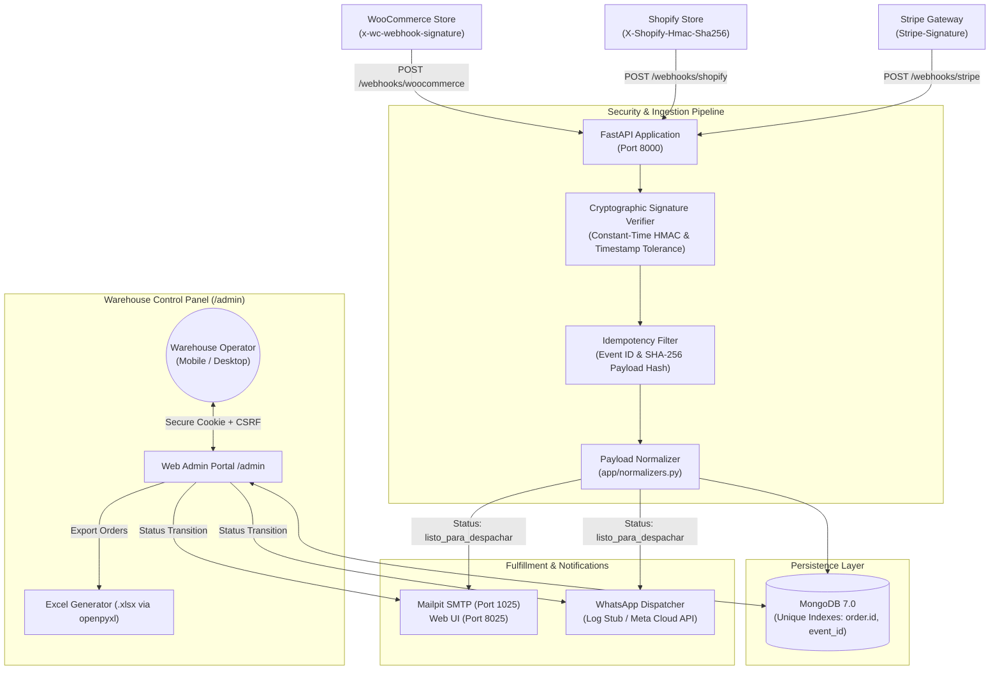

# Café de Origen · E-commerce Order Automation

> Centralized multi-channel order fulfillment automation that unifies e-commerce orders and payments from **WooCommerce**, **Shopify**, and **Stripe** into a canonical domain model with **MongoDB** persistence, automated customer notifications (Email and WhatsApp), and a secure administrative dashboard for warehouse fulfillment.

---

## Business Value & Problem Statement

Growing direct-to-consumer (DTC) brands and specialty coffee roasters frequently sell across multiple channels: their primary storefronts (WooCommerce and Shopify), direct payment links, and hosted checkouts (Stripe). In a traditional setup, warehouse operators must log into three disconnected merchant dashboards, copy-paste shipping addresses into spreadsheets, manually verify fraud indicators, and send tracking numbers to customers individually via messaging apps. This fragmented workflow causes human fulfillment errors, duplicated shipments, fulfillment bottlenecks, and poor customer communication.

**This service solves the problem by providing:**
1. **Unified Ingestion:** Normalizes disparate JSON payloads from WooCommerce (`order.created`), Shopify (`orders/create`), and Stripe (`payment_intent.succeeded`) into a single canonical `Order` model.
2. **Cryptographic Webhook Verification:** Verifies signatures using constant-time comparisons (HMAC-SHA256 Base64 for WooCommerce and Shopify; official `Stripe-Signature` with a 300-second timestamp drift tolerance).
3. **Guaranteed Idempotency:** Tracks incoming event identifiers and payload SHA-256 hashes in MongoDB, dropping duplicated delivery attempts without re-processing payments or re-triggering inventory changes.
4. **Automated Customer Dispatch Notifications:** Automatically sends branded order confirmation emails via SMTP (Mailpit in development) and dispatches WhatsApp alerts (via a pluggable interface with a local log stub and Meta WhatsApp Cloud API integration) once payment is verified (`listo_para_despachar`).
5. **Mobile-Ready Warehouse Admin Portal (`/admin`):** Secure administrative interface protected by PBKDF2 password hashing, signed `HttpOnly` session cookies, per-session CSRF tokens, and brute-force lockout (5 failed attempts trigger a 15-minute lock). Warehouse operators can filter orders, transition statuses (`listo_para_despachar` &rarr; `despachado` &rarr; `entregado`), and export filtered lists to Microsoft Excel (`.xlsx`).

---

## System Architecture



---

## How to Run It

### Option A: Quickstart with Docker Compose (Recommended)

The entire stack (FastAPI app, MongoDB 7.0, and Mailpit SMTP) runs out of the box with Docker Compose:

```bash
# 1. Clone the repository and navigate into the folder
cd ecommerce-order-automation

# 2. Configure environment variables from the template
copy .env.example .env

# 3. Build and launch all services in detached mode
docker compose up -d --build
```

#### Available Services & Port Mappings
- **Fulfillment Admin Dashboard:** [http://localhost:8000/admin](http://localhost:8000/admin)
  - Default Username: `admin`
  - Default Password: `change_me_admin_password`
- **Mailpit Web Email Inbox:** [http://localhost:8025](http://localhost:8025)
- **API Health Check:** [http://localhost:8000/health](http://localhost:8000/health)
- **MongoDB Database:** `localhost:27017`

To stop the containers:
```bash
docker compose down
```

---

### Option B: Local Python Development

For local development with Python 3.12:

```bash
# 1. Create and activate a virtual environment
python -m venv .venv
# On Windows:
.\.venv\Scripts\Activate.ps1
# On Linux/macOS:
source .venv/bin/activate

# 2. Install dependencies
pip install -r requirements-dev.txt

# 3. Run the development server
uvicorn app.main:app --host 0.0.0.0 --port 8000 --reload
```

---

## Live Webhook Demonstration (`samples/`)

The `samples/` directory provides valid sample payloads for all three platforms and an automated test runner script that cryptographically signs and transmits test orders:

```bash
# Ensure the application is running on http://localhost:8000
python samples/send_webhooks.py
```

The script executes 5 verification steps:
1. **[WooCommerce]** Sends a multi-item order (`ORD-WC-501`, $86,000 COP) &rarr; HTTP 200 `processed`.
2. **[Shopify]** Sends a single-item order (`ORD-SHP-1042`, $55,000 COP) &rarr; HTTP 200 `processed`.
3. **[Stripe]** Sends a confirmed payment intent (`ORD-STP-ABC999`, $84,000 COP) &rarr; HTTP 200 `processed`.
4. **[Idempotency]** Re-sends the WooCommerce order &rarr; HTTP 200 `ignored (duplicate_event)`.
5. **[Security]** Sends a modified payload with a forged signature &rarr; HTTP 401 `Unauthorized`.

Check the admin dashboard at [http://localhost:8000/admin](http://localhost:8000/admin) to view the consolidated orders, and check [http://localhost:8025](http://localhost:8025) to view customer notification emails.

---

## Automated Test Suite

The test suite covers normalization, cryptographic verification, idempotency concurrency, status transitions, admin authentication, CSRF validation, and Excel reporting.

Run pytest inside the virtual environment:

```bash
python -m pytest -q
```

### Test Coverage Highlights
- `tests/test_normalization.py`: Validates that every unified field matches the specification in `docs/FIELD-MAPPING.md` across WooCommerce, Shopify, and Stripe, including synthetic item fallbacks.
- `tests/test_webhooks.py`: Tests valid, altered, and missing HMAC signatures, plus expired Stripe timestamps (>300s).
- `tests/test_idempotency.py`: Validates sequential deduplication and 10 simultaneous concurrent deliveries (race condition test).
- `tests/test_order_status.py`: Tests state transitions (`listo_para_despachar` &rarr; `despachado` &rarr; `entregado`) and rejection of invalid states.
- `tests/test_admin_auth.py`: Tests login, invalid credentials, rate limiting (HTTP 429 lockout after 5 failures), and logout.
- `tests/test_csrf.py`: Tests form submission CSRF rejection when tokens are invalid, expired, or missing.
- `tests/test_export.py`: Tests the generated `.xlsx` binary spreadsheet structure and data rows.

---

## Known Limitations

1. **Discarded Platform Timestamps:** The normalizers (`app/normalizers.py`) set `created_at` and `updated_at` to `datetime.now(timezone.utc)` at the moment the webhook is processed. The original source timestamps (`date_created` in WooCommerce, `created_at` in Shopify, `created` in Stripe) are discarded.
2. **Stripe Line Items Requirement:** Stripe `PaymentIntent` webhooks do not natively include order item arrays. The Stripe normalizer parses items only if serialized as a JSON string inside `metadata.items`. If absent or malformed, it creates a single fallback synthetic item (`CF-STRIPE-PAY`) equal to the total payment amount.
3. **Currency Sub-Unit Heuristic:** Stripe amounts are divided by 100 if `>= 100` (`amount / 100.0`). While standard for currencies with two decimal places (e.g., USD, EUR, or cent-represented COP), zero-decimal currency configurations or sub-unit amounts (< 100) are not handled dynamically.
4. **Unidirectional Synchronization:** Status updates made by warehouse operators in `/admin` update local MongoDB records and send customer notifications, but do not push updates back to upstream store APIs (e.g., updating fulfillment on Shopify or marking orders completed in WooCommerce).
5. **Secondary Address Truncation:** Only primary street address lines (`address_1`, `address1`, `line1`) are mapped to `ShippingAddress.street`. Secondary apartment/suite details (`address_2`, `line2`) are discarded.
6. **In-Memory Brute Force State:** The login rate-limiter and lockout tracker in `app/security.py` stores attempt counters in an in-memory dictionary (`_login_attempts`). Restarting the server or running behind multi-worker process pools without shared caching resets lockout state.

---

## Documentation Links

- [Field Mapping Specification (docs/FIELD-MAPPING.md)](docs/FIELD-MAPPING.md)
- [Operations Runbook (docs/RUNBOOK.md)](docs/RUNBOOK.md)
- [Customer Demo Script - 5 Minutes (docs/DEMO-SCRIPT.md)](docs/DEMO-SCRIPT.md)
- [Test Accounts Setup Guide - Shopify & Stripe (docs/CUENTAS.md)](docs/CUENTAS.md)
