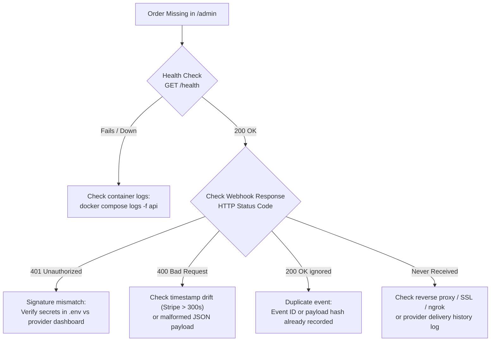

# Operations Runbook: E-commerce Order Automation

This runbook provides actionable procedures for operating, configuring, troubleshooting, and maintaining the Café de Origen centralized fulfillment service.

---

## 1. Starting and Stopping the Service

### A. Docker Compose (Production & Staging Standard)

The service is orchestrated with MongoDB 7.0, Mailpit (SMTP server + web viewer), and the FastAPI application:

```bash
# Start all containers in detached mode (builds API image if needed)
docker compose up -d --build

# View real-time logs from the API container
docker compose logs -f api

# Check container health status
docker compose ps

# Gracefully stop all services (persisting MongoDB data volume)
docker compose down

# Stop and wipe persistent database volume (destructive)
docker compose down -v
```

### B. Local Development Environment (Python 3.12 + Virtualenv)

```bash
# 1. Activate virtual environment
# Windows PowerShell:
.\.venv\Scripts\Activate.ps1
# Linux / macOS:
source .venv/bin/activate

# 2. Run local server using Uvicorn
uvicorn app.main:app --host 0.0.0.0 --port 8000 --reload

# 3. Stop local server
Press Ctrl + C
```

---

## 2. Configuration Variables

All configuration is loaded through `app/config.py` using Pydantic Settings from system environment variables or a local `.env` file.

| Variable Name | Default Value | Description | Criticality |
|---|---|---|---|
| `MONGO_URI` | `mongodb://localhost:27017` | MongoDB connection string. In Docker Compose, points to `mongodb://mongo:27017/cafe_de_origen`. | High |
| `MONGO_DB_NAME` | `cafe_de_origen` | Target MongoDB database name. | High |
| `SMTP_HOST` | `localhost` | SMTP relay server (e.g., `mailpit` in Docker, `smtp.sendgrid.net` in prod). | High |
| `SMTP_PORT` | `1025` | SMTP port (`1025` for Mailpit, `587` for TLS relay). | Medium |
| `SMTP_FROM` | `pedidos@cafedeorigen.co` | Sender email address appearing on customer order confirmations. | Medium |
| `WOOCOMMERCE_WEBHOOK_SECRET` | `change_me_woocommerce_secret` | Shared secret key for verifying WooCommerce HMAC-SHA256 signatures (`x-wc-webhook-signature`). | Critical |
| `SHOPIFY_WEBHOOK_SECRET` | `change_me_shopify_secret` | Shared secret key for verifying Shopify HMAC-SHA256 signatures (`X-Shopify-Hmac-Sha256`). | Critical |
| `STRIPE_WEBHOOK_SECRET` | `whsec_change_me_stripe_secret` | Webhook endpoint secret from Stripe Dashboard (`whsec_...`) used with `Stripe-Signature`. | Critical |
| `ADMIN_USERNAME` | `admin` | Username required to access the `/admin` portal. | High |
| `ADMIN_PASSWORD` | `change_me_admin_password` | Master password for `/admin`. Will be hashed with PBKDF2-HMAC-SHA256 upon first use. | Critical |
| `SECRET_KEY` | `change_me_session_secret_key` | Secret key used to sign `cafe_admin_session` cookies and CSRF tokens. | Critical |
| `WHATSAPP_API_TOKEN` | `None` | Bearer token for Meta WhatsApp Cloud API. If unset, uses internal log notifier. | Low |
| `WHATSAPP_PHONE_NUMBER_ID` | `None` | Meta Phone Number ID. Required when `WHATSAPP_API_TOKEN` is set. | Low |
| `TESTING` | `False` | When `True`, switches persistence to `InMemoryRepository` and reduces PBKDF2 rounds. | Internal |

---

## 3. Webhook Secret Rotation Procedure

When rotating a webhook secret, execute the following steps to avoid dropping inbound orders:

### WooCommerce Secret Rotation
1. Log in to WordPress Admin &rarr; **WooCommerce** &rarr; **Settings** &rarr; **Advanced** &rarr; **Webhooks**.
2. Select the `order.created` webhook.
3. In the **Secret** field, enter the newly generated high-entropy random string.
4. Save the webhook in WordPress.
5. Update `WOOCOMMERCE_WEBHOOK_SECRET` in `.env` on the host server.
6. Restart the API service: `docker compose restart api`.

### Shopify Secret Rotation
1. Log in to Shopify Admin &rarr; **Settings** &rarr; **Notifications** &rarr; **Webhooks**.
2. Scroll to the bottom to view the webhook signing secret.
3. If rotating, delete the existing webhook destination and re-add `orders/create` pointing to `https://<domain>/webhooks/shopify`.
4. Copy the newly displayed shared secret.
5. Update `SHOPIFY_WEBHOOK_SECRET` in `.env`.
6. Restart the API service: `docker compose restart api`.

### Stripe Secret Rotation
1. Log in to Stripe Dashboard &rarr; **Developers** &rarr; **Webhooks**.
2. Select the endpoint URL for `https://<domain>/webhooks/stripe`.
3. In the **Signing secret** card, click **Roll secret** (Stripe keeps both the current and new secret active for up to 24 hours to prevent dropped events).
4. Copy the new secret string (`whsec_...`).
5. Update `STRIPE_WEBHOOK_SECRET` in `.env`.
6. Restart the API service: `docker compose restart api`.
7. Once verified, expire the old secret in Stripe.

---

## 4. Troubleshooting: When an Order Does Not Arrive

Follow this diagnostic checklist when a webhook was emitted but the order does not appear in `/admin/orders`:



### Detailed Diagnostics

1. **Verify Service Health:**
   ```bash
   curl -I http://localhost:8000/health
   # Expected response: HTTP/1.1 200 OK
   ```

2. **Check Webhook Ingestion Logs:**
   Filter logs for webhook rejection notices:
   ```bash
   docker compose logs api | grep -E "(401|400|rechazada|inválida)"
   ```
   - **401 Unauthorized:** Occurs if `x-wc-webhook-signature` or `X-Shopify-Hmac-Sha256` does not match the computed HMAC. Ensure the raw webhook body was not modified by an intermediary proxy (e.g. reverse-proxy JSON reformatting).
   - **400 Bad Request (Stripe):** Occurs if the server clock has drifted by more than 300 seconds compared to Stripe's header timestamp `t=...`, or if the payload JSON is malformed.

3. **Check for Duplicate Event Drop:**
   If the webhook responded `200 OK` with `{"status": "ignored", "reason": "duplicate_event"}`:
   - Check if an identical event or order was previously ingested. Query MongoDB:
     ```bash
     docker compose exec mongo mongosh cafe_de_origen --eval 'db.events.find({event_id: "<event_id>"})'
     ```

4. **Verify Provider Webhook History:**
   - **Shopify:** Settings &rarr; Notifications &rarr; Webhooks &rarr; Click webhook &rarr; Delivery History.
   - **WooCommerce:** WooCommerce &rarr; Status &rarr; Logs &rarr; Select `webhooks-delivery-...`.
   - **Stripe:** Developers &rarr; Webhooks &rarr; Click endpoint &rarr; Filter failed requests.

---

## 5. Reprocessing an Order

Because the system applies strict idempotency filters on `event_id`, `payload_hash`, and `order.id`, replaying an order requires handling the existing records:

### Method A: Manual State Progression via Admin UI
If the order is already in the database (e.g. stuck in `pendiente` because payment confirmation came later):
1. Log in to [http://localhost:8000/admin/orders](http://localhost:8000/admin/orders).
2. Open the order detail view (`/admin/orders/{order_id}`).
3. In the update status form, select `listo_para_despachar` or `despachado`.
4. Enter an audit note and submit. This triggers both email and WhatsApp dispatch alerts immediately.

### Method B: Complete Webhook Replay
If the event must be fully re-ingested from the source platform:
1. Connect to MongoDB and remove the event and order record:
   ```bash
   docker compose exec mongo mongosh cafe_de_origen --eval '
     db.events.deleteOne({order_id: "ORD-WC-501"});
     db.orders.deleteOne({id: "ORD-WC-501"});
   '
   ```
2. In Shopify/WooCommerce/Stripe dashboard, click **Resend Webhook** (or re-run `python samples/send_webhooks.py`).
3. Check `/admin/orders` to verify the reprocessed order appears.

---

## 6. Database Backup and Restore Procedures

The application stores orders, events, and products in MongoDB inside collection `cafe_de_origen`.

### A. Creating a Backup (`mongodump`)

```bash
# Execute mongodump inside the container and output to mounted volume
docker compose exec mongo mongodump \
  --db=cafe_de_origen \
  --out=/data/db/backup_$(date +%Y%m%d_%H%M%S)

# Alternatively, dump directly from host machine via port 27017:
mongodump --uri="mongodb://localhost:27017/cafe_de_origen" --out=./db_backups/backup_$(date +%Y%m%d_%H%M%S)
```

### B. Restoring from a Backup (`mongorestore`)

```bash
# Restore specific backup folder into MongoDB
mongorestore --uri="mongodb://localhost:27017/cafe_de_origen" \
  --nsInclude="cafe_de_origen.*" \
  --drop \
  ./db_backups/backup_20261014_120000/cafe_de_origen
```

> [!WARNING]
> The `--drop` flag removes existing collections before restoring. Omit `--drop` if you only want to restore missing documents without clearing existing records.

### C. Docker Volume Snapshot

For total disaster recovery, backup the underlying Docker named volume `cafe_mongo_data`:

```bash
# Snapshot the data volume to a compressed tar archive:
docker run --rm \
  -v cafe_mongo_data:/volume \
  -v ${PWD}:/backup \
  alpine tar czf /backup/mongo_data_snapshot.tar.gz -C /volume .
```
