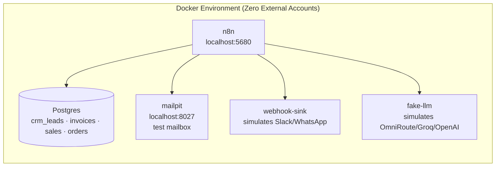
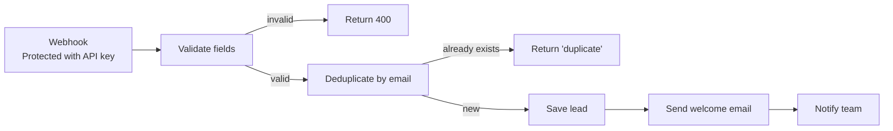
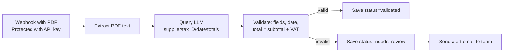
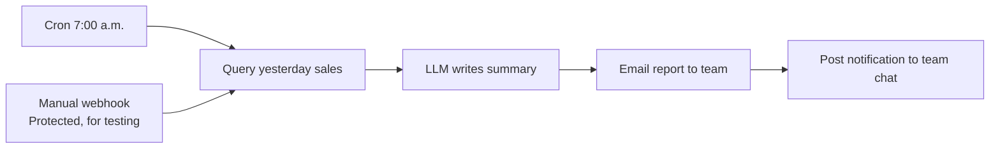
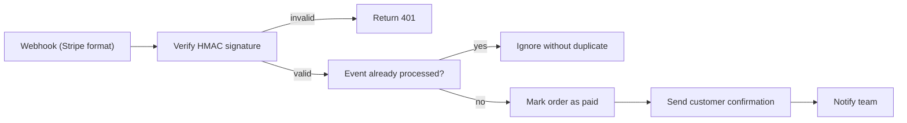

# Sabor de Casa — n8n Automation Pack

Four automated workflows for a restaurant or service business with equivalent operational patterns (web forms, supplier invoices, sales reporting, and online payments), built with [n8n](https://n8n.io). The complete stack runs **locally in Docker with zero external accounts required**, enabling end-to-end evaluation before connecting to production services (HubSpot, Google Sheets, Gmail, Stripe/Wompi, WhatsApp).

---

## 1. The Problem

In a small to medium restaurant, four repetitive manual workflows consume daily staff time:

- Manually copying event quote inquiries from web forms into a spreadsheet or CRM.
- Manually transcribing paper/PDF supplier invoices (produce, meat, beverages) for accounting.
- Manually assembling daily sales summary reports every morning.
- Cross-checking payment notifications one by one to mark orders as paid.

These manual tasks are error-prone, repetitive, and take staff away from customer service. The four workflows in this pack automate these routines consistently, alerting human staff only when an exception requires manual review.

---

## 2. Automated Workflows

| Flow | Description | Time Saved |
|---|---|---|
| **F1** Web Form Lead → CRM | Ingests website event quote submissions → validates required fields, deduplicates by email against Postgres `crm_leads`, persists lead, sends welcome email via Mailpit, alerts staff via webhook. | ~5 min per lead; prevents dropped inquiries. |
| **F2** Supplier Invoice PDF → Structured Data | Ingests invoice PDF via webhook → extracts text, LLM extracts supplier name, tax ID (NIT), date, subtotal, VAT, total, and line items; validates totals (`total = subtotal + iva`) and date validity; saves status as `validated` or flags as `needs_review` with an alert email. | ~10-15 min data entry per invoice. |
| **F3** Daily Sales Report with AI | Scheduled cron trigger at 7:00 a.m. (or manual webhook for testing) → queries previous day sales from Postgres `sales`, LLM synthesizes an executive summary, delivers via email (Mailpit) and team chat webhook. | ~15 min daily report drafting. |
| **F4** Payment Received → Order Fulfillment | Ingests payment webhook (Stripe/Wompi format) → verifies HMAC signature, checks idempotency against `processed_events` to ignore duplicate retries, marks order as paid in `orders`, sends customer confirmation email, alerts staff. | Eliminates duplicate processing and missed payment updates. |

**Scope Boundary:** This pack intentionally does not replace managerial business decisions (pricing exceptions, custom client disputes) and does not provide a custom frontend—all workflows operate within the n8n interface or connect directly to existing business backends (CRM, email, Sheets).

---

## 3. Demo & Walkthrough

> *(placeholder) Screenshot of n8n canvas with the 4 active workflows.*
>
> *(placeholder) Screenshot of welcome email in Mailpit inbox.*
>
> *(placeholder) 2-minute walkthrough GIF, see `docs/DEMO-SCRIPT.md`.*

Complete 2-minute demo guide in [`docs/DEMO-SCRIPT.md`](docs/DEMO-SCRIPT.md).

---

## 4. Architecture



Each workflow runs independently inside the n8n instance. All four workflows share a centralized error handler (`Shared Error Handler`): unhandled failures across any workflow are recorded in the `workflow_errors` table and trigger an incident email to the team without exposing sensitive environment variables.

### F1 — Form Lead to CRM



### F2 — Invoice PDF to Data



### F3 — Daily Sales Report with AI



### F4 — Payment Received to Order Fulfillment



---

## 5. Running Locally

**Prerequisites:** Docker and Docker Compose.

```powershell
# 1. Start all services (postgres, n8n, mailpit, webhook-sink, fake-llm) and import workflows
docker compose --env-file .env.example up -d --build --wait

# 2. Verify all containers are healthy
docker compose ps
```

No manual `.env` file creation is required for local runs: `n8n-init` configures Postgres, SMTP, and webhook API key credentials directly from `.env.example` placeholders on first startup (`change_me_...`).

- **n8n Canvas / Editor:** http://localhost:5680
- **Mailpit Web UI (Test Mailbox):** http://localhost:8027

To test each workflow from the terminal:

```powershell
# F1 — Ingest a new lead
curl -X POST http://localhost:5680/webhook/lead-form -H "X-Api-Key: change_me_webhook_api_key" -H "Content-Type: application/json" -d "{\"name\":\"Ana Gomez\",\"email\":\"ana@example.com\",\"event_type\":\"matrimonio\",\"guests\":40}"

# F2 — Process a sample invoice (see samples/)
curl -X POST http://localhost:5680/webhook/invoice-upload -H "X-Api-Key: change_me_webhook_api_key" -H "Content-Type: application/pdf" --data-binary "@samples/factura-valida.pdf"

# F3 — Trigger sales report on-demand (date is optional, YYYY-MM-DD; 2025-01-15 is seeded in init-db.sql)
curl -X POST http://localhost:5680/webhook/daily-report-trigger -H "X-Api-Key: change_me_webhook_api_key" -H "Content-Type: application/json" -d "{\"date\":\"2025-01-15\"}"

# F4 — Requires HMAC signature calculation; see docs/DEMO-SCRIPT.md for instructions
```

After triggering tests, open http://localhost:8027 to review generated emails.

---

## 6. Moving to Production

Transitioning to production requires updating target destination nodes and credentials inside n8n without restructuring business logic:

| Flow | Local Environment | Production Environment |
|---|---|---|
| F1 | Saves to Postgres, email via Mailpit, alerts via `webhook-sink` | HubSpot or Airtable node; production SMTP credential; Slack/WhatsApp alert node |
| F2 | Webhook simulates invoice arrival; LLM is `fake-llm` | Gmail/IMAP trigger node instead of webhook; Google Sheets node instead of Postgres |
| F3 | Cron + manual webhook; reads/writes Postgres | Production database/Sheets node; live email and Slack channels |
| F4 | Webhook with local HMAC secret | Production Stripe or Wompi webhook endpoint; WhatsApp Cloud API customer confirmation |

**LLM Configuration (F2 and F3):** Set `LLM_BASE_URL`, `LLM_MODEL`, and `LLM_API_KEY` in your production environment to target Groq, OpenAI, or an OpenAI-compatible proxy (`POST /v1/chat/completions`), and store the API token in the **"LLM API Key"** credential. Because `n8n-init` bakes endpoint URLs into workflow JSON on import (preventing expressions from reading container environment variables), switching providers requires re-running `n8n-init`.

| Provider | `LLM_BASE_URL` | Example `LLM_MODEL` |
|---|---|---|
| Groq | `https://api.groq.com/openai/v1` | `llama-3.3-70b-versatile` |
| OpenAI | `https://api.openai.com/v1` | `gpt-4o-mini` |
| OmniRoute / Compatible Proxy | Proxy URL | Configured proxy model |

---

## 7. Importing into an Existing n8n Instance

1. In n8n, navigate to **Workflows → Import from File** and upload each JSON file from `workflows/*.json`.
2. Configure credentials with matching names (n8n assigns internal IDs automatically):
   - **Postgres - Sabor de Casa** (or client database)
   - **Mailpit SMTP** → replace with client production SMTP
   - **Webhook API Key** (Header Auth, `X-Api-Key`) → generate a production key
   - **Payment Webhook HMAC** (Crypto, HMAC) → payment provider secret
   - **LLM API Key** (Header Auth, `Authorization: Bearer ...`) → LLM provider key
3. Replace Postgres/Mailpit/`webhook-sink` destination nodes with production services (HubSpot, Sheets, Slack).
4. Activate each workflow.

---

## 8. Security

- Webhooks F1, F2, and F3 manual trigger require a valid `X-Api-Key` header; invalid requests are rejected with HTTP 401 before workflow execution.
- Webhook F4 verifies signatures (`X-Signature: sha256=...`) using constant-time string comparison (`crypto.timingSafeEqual`) to protect against timing attacks.
- No repository files contain production secrets: `credentials/*.json` and `workflows/*.json` contain `${VARIABLE}` placeholders resolved at container startup from `.env.example`.
- The n8n container runs with `N8N_BLOCK_ENV_ACCESS_IN_NODE` at its secure default (`true`), preventing workflow expressions or Code nodes from accessing container secrets (`N8N_ENCRYPTION_KEY`, `DB_POSTGRESDB_PASSWORD`).

---

## 9. Tests and Code Quality

```powershell
# Unit tests (run locally without Docker)
.venv\Scripts\python.exe -m pytest -q

# Integration tests (against live Docker stack)
.venv\Scripts\python.exe -m pytest -q -m integration

# Linting and style check
.venv\Scripts\ruff.exe check .
```
